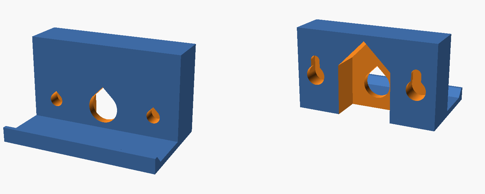

# Playdate magnetic dock: wall bracket

A wall-mount adapter for the
[Playdate Magnetic Charging Dock](https://makerworld.com/en/models/1635754)
on MakerWorld. It replaces the angled desk foot (`playdate base.stl`) and
clamps to the dock the same way the foot does: the two alignment pegs drop into
sockets and the cable nut screws onto the holder from behind. The bracket then
hangs on two wall screws through keyhole slots.



This is a new part designed to fit the original; it contains none of the
original model's files. You still print every other part of the dock from the
MakerWorld download.

## What changes

| Desk stand | Wall bracket |
| --- | --- |
| Angled foot tilts the dock back | Dock hangs flat, 20 mm off the wall |
| Cable exits behind the foot | Cable bends down inside the bracket and drops out the bottom |
| Playdate held by magnets only | Optional ledge under the dock and Playdate catches it if it slips |

## Measure before printing

I couldn't download the original STLs (MakerWorld needs a login), so the
interface dimensions are estimates from the model's photos and assembly
diagrams. Check these in `playdate_wall_bracket.scad` against your printed
parts (calipers on the original foot are easiest), then re-export:

| Parameter | Default | What to measure |
| --- | --- | --- |
| `dock_width` | 78 | Outer width of the dock |
| `dock_depth` | 16 | Dock thickness, back plate to magnet face |
| `iface_z` | 10 | Dock bottom edge to the centre of the cable nut |
| `peg_spacing` | 50 | Centre-to-centre of the two alignment pegs |
| `peg_d` | 6.0 | Alignment peg diameter |
| `holder_d` | 14.0 | Outer diameter of the threaded nut holder |
| `mount_t` | 4 | Thickness of the original foot's flat top plate (the holder thread is sized to clamp this) |
| `nut_flange_d` | 22 | Largest diameter of the cable nut |

The other settings (standoff, ledge, screw size and spacing) are in the same
file. Open it in OpenSCAD and use the Customizer panel, or export from the
command line:

```sh
openscad -o playdate_wall_bracket.stl playdate_wall_bracket.scad
```

The included `playdate_wall_bracket.stl` uses the defaults above.

## Printing

- Print it upright, as it sits on the wall, with the ledge flat on the bed.
  Every hole and overhang is shaped to print without supports.
- PLA or PETG, 3 or more walls, 20% or more infill. The keyhole slots carry
  the load, so don't skimp on walls.

## Assembly

1. Build the dock as in the original instructions, but leave the cable nut off.
2. Feed the cable through the large centre hole from the dock side, seat the
   pegs in their sockets, and screw the nut onto the holder from inside the
   open pocket on the wall side.
3. Bend the cable down and out through the gap in the bottom of the bracket.
4. Put two screws in the wall, 54 mm apart and level, with the heads standing
   about 3 mm out from the wall. Defaults suit #8 or 4 mm wood screws
   (head up to 9 mm). Use wall plugs in drywall.
5. Line the round keyhole openings up with the screw heads, push in, and let
   the dock drop about 8 mm to lock. If it's loose, turn the screws in a
   little; if it won't go on, back them out.
